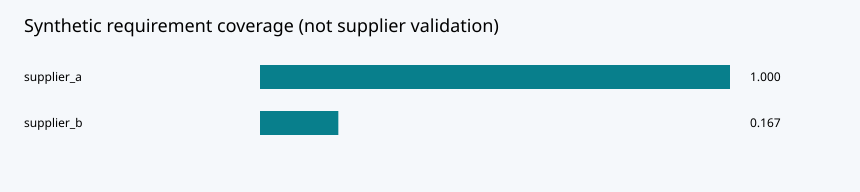

# Enterprise AI Assistant & Supplier Requirements Analysis

A runnable, independent **Business × AI research MVP** for a European enterprise master's thesis portfolio. Developed with AI assistance. All bundled data and business outcomes are **synthetic**; no employer files, real supplier records or personal customer data are used.

**Research question:** Can a traceable requirement-level assistant reduce missed supplier exceptions while keeping decision authority with a reviewer?

**Thesis-topic alignment (user-supplied target):** Scania — AI-Assisted Requirements Management and Supplier Response Analysis; Derome — Enterprise AI Assistant. This is a thematic alignment, not an affiliated company project, endorsed application, or verification of an open vacancy.

## What runs

- Line-level structured document extraction with strict parsing and provenance
- Supplier-by-requirement comparisons: met, missing, exception, unknown and unit/topic mismatch
- TF-IDF retrieval and extractive answers with exact source file/line citations
- Fixture status evaluation and retrieval benchmark, including a lexical failure case
- Blocked approval for unresolved exceptions, persistent human review and hash-chain audit



## Quick start — no paid API key

Python 3.10 or newer. Run from this repository's root in its own environment:

```bash
python -m venv .venv
# Linux/macOS:
source .venv/bin/activate
# Windows PowerShell alternative: .venv\Scripts\Activate.ps1
python -m pip install -r requirements-dev.txt
python -m portfolio.demo
python -m pytest -q
python -m streamlit run app.py --server.address 127.0.0.1
```

Open the localhost URL printed by Streamlit (normally port 8501). `python -m portfolio.demo` rebuilds committed JSON results and the SVG without third-party dependencies. Dashboard and UI tests require Streamlit and pandas. Install each project separately: they intentionally share the same local `portfolio` package name and are not designed to be installed together.

## Reviewer walkthrough

See [DEMO.md](docs/DEMO.md) for a guided scenario and [RESEARCH_REPORT.md](reports/RESEARCH_REPORT.md) for methods, computed outputs, limitations and a feasible thesis study. [DATA.md](docs/DATA.md) describes the synthetic data and metric definitions. [REUSE.md](docs/REUSE.md) documents the existing-repository review and component reuse.

The UI never executes a purchase or publishes marketing content. Where human reviews are enabled, decisions are stored in ignored `runtime/audit.sqlite`. Reviewer aliases are self-declared; approval is a demonstration of workflow state, not legal or organizational authorization. A completed version cannot be reviewed twice; edits create a new artifact hash. Hash chains detect edits but do not prevent deletion or wholesale rewriting by an administrator.

## Structure

- `portfolio/`: domain logic, reusable charts, review storage and CLI experiment
- `app.py`: interactive Streamlit dashboard
- `data/`: fictional inputs, documented in `docs/DATA.md`
- `tests/`: analytical, boundary, governance and UI tests
- `results/`: reproducible computed outputs and visualization
- `reports/`: English research report and test evidence
- `.github/workflows/tests.yml`: CI definition (remote CI status is reported only after execution)

## Verification and limits

The parser supports a declared pipe-delimited text contract, not arbitrary PDFs or OCR. Numeric operators are limited to <= and >=; units must match exactly. Retrieval is lexical, not semantic. Extractive answers are not LLM reasoning. Only six requirements, two suppliers and four retrieval queries are provided; the fixture accuracy is not a generalization estimate.

No business improvement, model accuracy on real documents, company adoption, live cloud API result or production readiness is claimed. See the report for the exact measurement boundary. Do not upload confidential data into this demonstration.

## License

MIT for code and original synthetic materials. Reused upstream code retains attribution in [REUSE.md](docs/REUSE.md).
